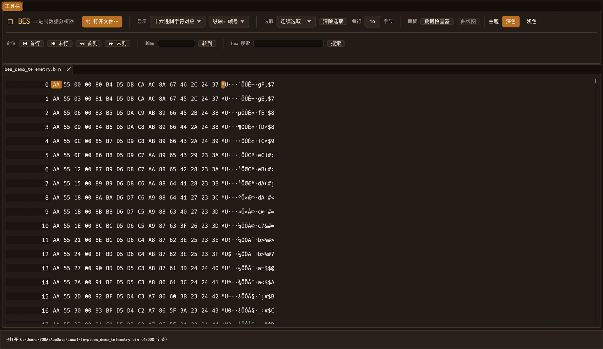
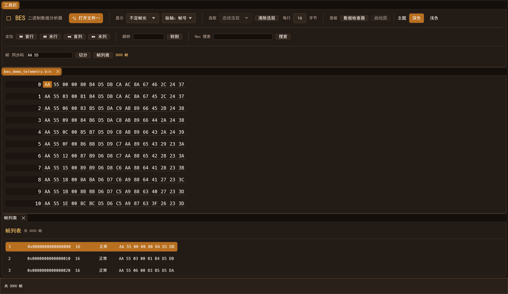
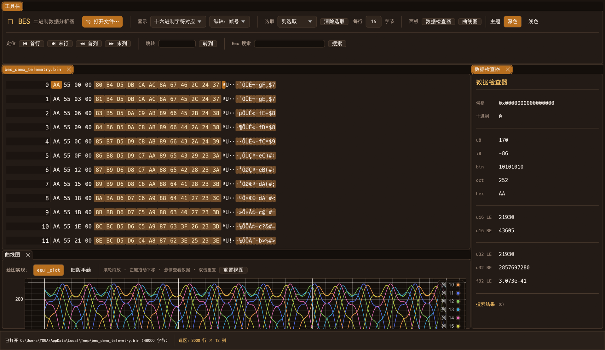

<p align="center">
  
</p>

<h1 align="center">BES · 二进制数据分析器</h1>

<p align="center">
  用 Rust + egui 重写的 BES。<b>任意大小的二进制文件</b>与<b>通信数据帧</b>，打开即看、按帧切分、框选取出曲线。
</p>

<p align="center">
  分页读取 + LRU 缓存 · 64 位偏移 · 全程只读 · 后台任务可取消
</p>

<p align="center">
  
</p>

## 这是什么

抓包抓下来的 `*.bin`、串口录下来的原始数据、固件导出的一块存储——这些文件用文本编辑器打开是乱码，用通用 Hex 编辑器又看不出帧结构。BES 就是为这种场景写的：

- 文件不整体读进内存，几个 GB 也能瞬间打开；
- 偏移 + Hex + 字符三栏对齐，看一眼就知道数据长什么样；
- 给出同步码，就能把整段数据切成一帧一帧，列表里排好；
- 挑出其中几列，直接画成曲线，比盯十六进制快得多。

## 界面速览

上图为**十六进制 / 字符对照**：每行字节数可调，纵轴可切换为帧号、帧长或起始比特。

**不定帧长**：填同步码（支持 `??` 通配）后一键切分，帧列表给出序号、起始偏移、长度、状态与摘要，点击即可定位。



**选取与曲线**：列选取后调出数据检查器和曲线图，多列数据在同一张图上对比，滚轮缩放、拖动平移、悬停读数。



## 核心能力

| 能力 | 说明 |
|---|---|
| 大文件查看 | 64 KiB 分页 + 512 页 LRU 缓存（约 32 MiB），按需读取，不整文件加载 |
| 六种显示模式 | 比特位图、等长帧比特字符、等长帧十六进制、字符方式、十六进制字符对应、不定帧长 |
| 虚拟化绘制 | 只绘制视口内的行，滚动位置与文件大小无关 |
| 搜索 | Hex 模式串搜索，支持 `??` 通配；后台线程执行，带进度，可随时取消 |
| 帧切分 | 同步码（支持 `??` 通配）切分，结果分批回传；`1,000,000` 帧 / `4,000,000` 候选上限保护 |
| 选取 | 连续 / 块 / 行 / 列四种模式，右键菜单可定位、导出、绘图 |
| 数据检查器 | 光标所在字节的 u8/i8、bin/oct/hex、u16 LE/BE、i16、f32 等多种解释 |
| 曲线图 | 列/块选取绘图，支持按列分别绘制或大端合并；egui_plot 与旧版手绘两种渲染 |
| 导出 | 选区按原始字节写入文件，后台执行并显示进度 |
| 工作区 | 文件、数据检查器、曲线图、帧列表都是可拖拽的停靠面板；深色 / 浅色主题 |
| 安全 | 全程只读；打开期间检测文件是否被外部修改，截断或越界读取返回错误而不是 panic |

## 快速开始

需要 Rust 1.85 及以上（本工程使用 edition 2024）；Windows 下建议使用 MSVC 工具链。

```bash
# 运行
cargo run --release

# 测试
cargo test

# 只构建
cargo build --release
```

可执行文件输出在 `target/release/main.exe`（Windows）。启动后点击「打开文件…」，或直接把文件拖进窗口。

常用交互：`Enter` 提交跳转 / 搜索 / 切分；在数据区右键打开选区菜单；曲线图双击重置视图。

## 项目结构

```text
src/
├── lib.rs                  库入口，导出文档、搜索、帧切分等公共类型
├── bin/main.rs             桌面入口（窗口参数、内嵌图标）
├── eframe_app/
│   ├── app.rs              应用状态、工具栏、工作区调度
│   ├── app/data_view.rs    Hex / 字符 / 比特视图与虚拟滚动
│   ├── app/curve_view.rs   曲线图绘制（egui_plot 与旧版手绘）
│   ├── app/workspace.rs    停靠布局与标签页
│   ├── document.rs         分页读取、LRU 页缓存、范围校验
│   ├── frame.rs            同步码解析与后台帧切分
│   ├── search.rs           后台 Hex 搜索
│   └── selection.rs        选区模型、曲线取数、导出
└── utils/egui_helper/      字体与图标加载
```

## 主要依赖

| crate | 用途 |
|---|---|
| `eframe` / `egui` | 原生窗口、即时模式 UI、wgpu 渲染后端 |
| `egui_dock` | 可停靠工作区布局 |
| `egui_plot` | 曲线图渲染 |
| `egui_inbox` | 后台任务 → UI 的事件投递 |
| `crossbeam-channel` | 搜索 / 帧切分 / 导出任务的进度与结果通道 |
| `lru` | 文件页缓存 |
| `memchr` | 同步码与搜索的快速字节扫描 |
| `rfd` | 系统文件对话框 |
| `thiserror` / `anyhow` | 领域错误类型与入口错误汇总 |
| `embed-resource` | 构建时把 Windows 图标资源写入可执行文件 |
| `tempfile` | 测试用临时文件 |

## 当前边界

- 只读工具：不做插入、删除和原地保存，避免误改原始数据；
- 帧切分目前只按同步码切分，长度字段、终止符、CRC 判定等策略尚未接入；
- 串口实时采集与实时帧切分属于后续规划；
- GUI 图层暂固定在使用 `egui 0.36` 的版本组合（`egui_dock` 尚未跟进 `egui 0.37`）。
